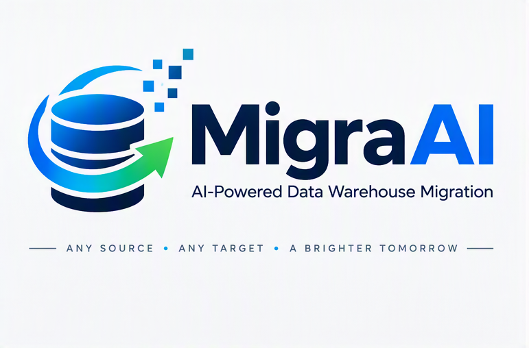

# MigraAI

MigraAI is a local platform for planning, converting, and validating enterprise data-warehouse migrations on Windows. Its portable architecture combines a FastAPI backend, React frontend, SQLite-based knowledge base, and LangGraph orchestration. Devin API provides conversion voting and escalation; object code and context are sent to Devin cloud as described in the Phase-Gate 0 plan.

**Status:** Phase 1 in progress

## Supported platforms

- **Sources:** Teradata, Oracle, SQL Server, Snowflake, Synapse, Db2 Warehouse, Hive, Netezza
- **Targets:** Databricks, Redshift, Snowflake, Fabric, BigQuery, Synapse, ClickHouse

## Documentation

- [Phase-Gate 0 plan](docs/phase-gate-0-plan.md)
- [Architecture](docs/architecture.md)
- [Agents](docs/agents.md)
- [Security](docs/security.md)
- [Knowledge base design](docs/kb-design.md)
- [Database schema](docs/db-schema.md)
- [API](docs/api.md)
- [Test strategy](docs/test-strategy.md)
- [Installation guide](docs/install-guide.md)
- [User guide](docs/user-guide.md)
- [Operations guide](docs/operations-guide.md)
- [Diagrams](docs/diagrams/)
- [Original requirements](docs/requirements/MigraAI-Requirements.docx)

## Repository layout

- `docs/` — project plan, requirements, diagrams, and documentation
- `backend/` — Python application and test scaffold
- `frontend/` — React frontend scaffold
- `testpacks/` — synthetic migration test packs
- `packaging/windows/` — portable Windows packaging scaffold
