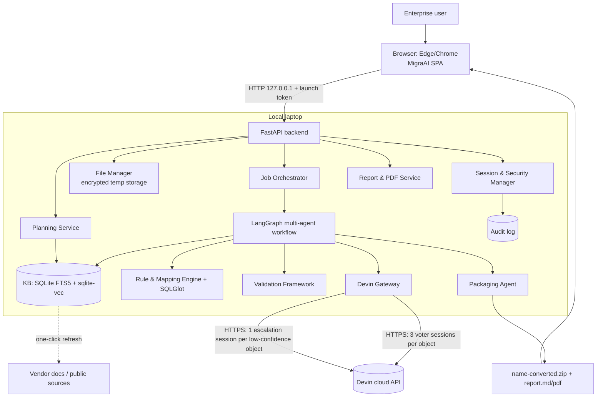
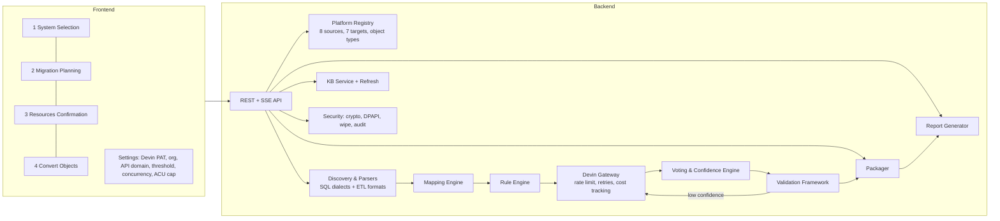
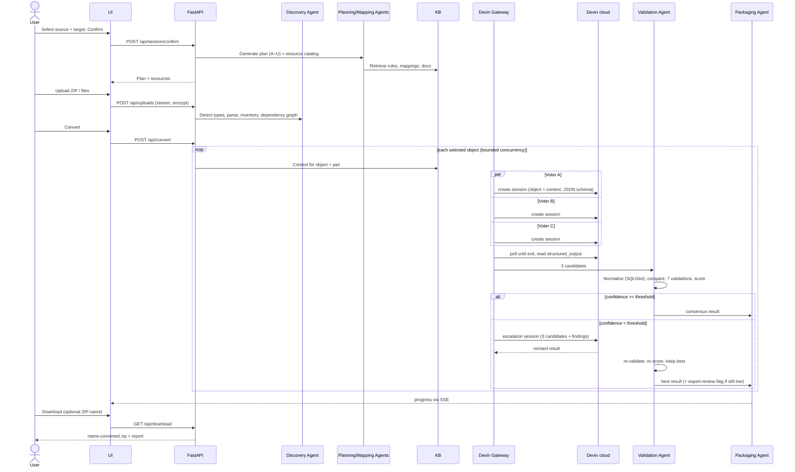
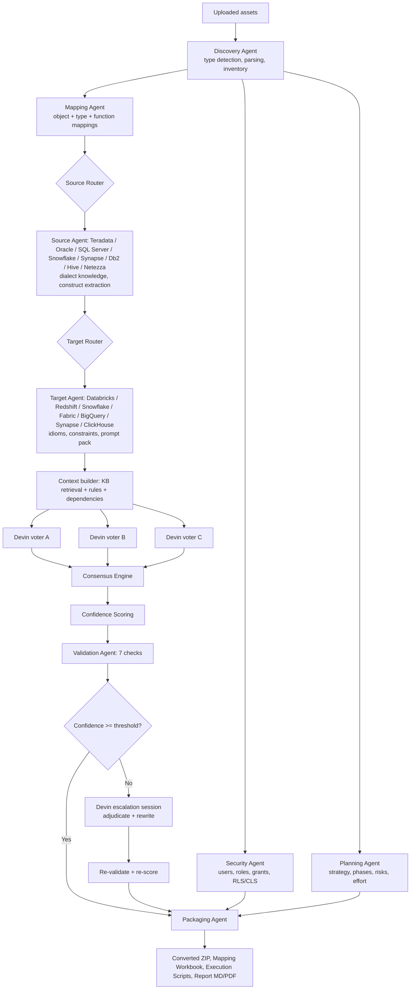
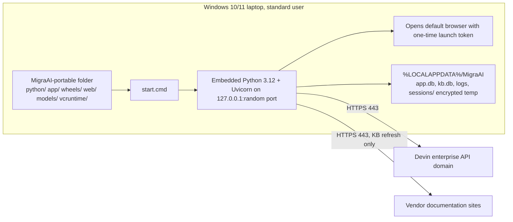

# MigraAI — Phase-Gate 0 Plan (for approval)

Enterprise Data Warehouse Migration Platform · Repo: `Cognition-Partner-Workshops/DWHMigrationDemo` · Status: **awaiting approval, no code written**

## 1. Requirements verified (from README.docx + 5 images)

| Area | Requirement | Plan response |
|---|---|---|
| Deployment | Local web app, Windows enterprise laptop, limited privileges | Portable Windows ZIP, UI on `127.0.0.1`, no admin, no installer |
| Sources (8) | Teradata, Oracle, SQL Server, Snowflake, Synapse, Db2 Warehouse, Hive, Netezza | Source agent + parser + rule pack per platform |
| Targets (7) | Databricks, Redshift, Snowflake, Fabric, BigQuery, Synapse, ClickHouse | Target agent + generator + rule pack per platform |
| Depth | **Equal depth for all 56 pairs** (your choice) | Composable rule packs (source × target) + pair overrides; golden tests for every pair |
| Objects | DB, ETL, security, data objects (full list in README) | Object-type registry; all types inventoried, mapped, converted |
| ETL | **Full ETL conversion in v1** (your choice) | Informatica, DataStage, SSIS, Airflow, Control-M, shell, Python ETL, Spark → target-native jobs |
| Conversion | KB + rules + mapping + multi-agent + multi-model voting + validation | LangGraph pipeline (section 5) |
| Voting | Model A/B/C → consensus → escalate below threshold | **3 parallel Devin sessions per object + 4th Devin session per low-confidence object** (your choice) |
| Explain | Inline comment for every conversion | Mandatory `-- Converted: / -- Reason:` blocks, enforced by validator |
| Planning | Sections A–U, largest screen area | Generated after Confirm, from KB + platform profiles; PDF export |
| Resources | Mandatory / Optional, dynamic per source, scrollable | Per-source resource catalog; counts from discovery |
| Upload | Multi-file, ZIP, drag-and-drop, 100 MB max | Streaming upload, type detection, ZIP-slip-safe extraction |
| Output | `<name>-converted.zip`; per file `-converted`; folder structure kept; user can name the ZIP for multi-file uploads | Packaging agent |
| Report | One per session; Markdown + PDF; 9 sections | Report service (Markdown → PDF) |
| Validation | Syntax, lint, semantic, rule, dependency, object-reference, security | Validation framework (section 7) |
| Security | GDPR/SOC2/ISO27001/HIPAA support; delete uploads on shutdown; encryption; isolation; audit | Section 8 |
| KB | Evaluate store; one-click refresh (fetch docs, re-embed, re-index) | SQLite hybrid (section 6) |
| Brand/UI | `myUI.png` layout, `logo.png` | **MigraAI** name + logo, myUI layout |

## 2. Decisions recorded (your answers)

| # | Decision |
|---|---|
| 1 | Devin cloud is the conversion engine: 3 parallel Devin sessions vote on **every object**; each low-confidence object is escalated to **its own** 4th Devin session. All submitted code leaves the laptop. |
| 2 | No network restrictions in the app. |
| 3 | Portable Windows ZIP (embedded Python 3.12, vendored wheels, prebuilt React, `start.cmd`). |
| 4 | KB = SQLite (FTS5 keyword) + `sqlite-vec` (vectors) + FastEmbed `bge-small-en-v1.5` (bundled offline). |
| 5 | LangGraph for agent orchestration. |
| 6 | Equal depth for all source/target pairs. |
| 7 | Full ETL conversion in v1. |
| 8 | Fresh codebase; new synthetic, inter-related test packs per source. |
| 9 | Docs + scaffold as first commit on `main`, then one PR per phase. |
| 10 | Devin **Personal Access Token**, entered in Settings, stored with Windows DPAPI. |

## 3. Final architecture recommendation

| Layer | Choice | Justification |
|---|---|---|
| Frontend | React 18 + TypeScript + Vite, built to static files and served by the backend | Matches Deployment diagram; no Node.js on the laptop at runtime |
| Backend | FastAPI + Uvicorn (single process, `127.0.0.1`) | Async I/O for many parallel Devin calls; small (3 MB + 0.3 MB measured) |
| Metadata storage | SQLite (WAL) per session, plus app DB for settings and audit | Zero install, single file, stdlib |
| Vector DB / RAG | SQLite FTS5 + `sqlite-vec` hybrid with reciprocal-rank fusion; FastEmbed ONNX embeddings | 0.3 MB extension; one DB for metadata + KB; no server process. ChromaDB failed to resolve on Windows; LanceDB 122 MB |
| Agent framework | LangGraph `StateGraph` with checkpointing to SQLite | Matches diagram; resumable runs; 7 MB pure Python |
| LLM layer | Devin v3 REST API (`POST /v3/organizations/{org_id}/sessions`, `GET .../sessions/{devin_id}`, `POST .../attachments`), structured JSON output | Your choice; enterprise API domain configurable |
| Deterministic layer | SQLGlot + rule engine | Parses/normalises SQL for voting comparison, validation and KB context; not a voter |
| PDF | Markdown → HTML → PDF with `xhtml2pdf` | Pure-Python wheels; WeasyPrint needs Pango DLLs (rejected) |
| Packaging | Portable ZIP built by `packaging/windows/build_portable.py`; VC++ 2019 runtime DLLs shipped app-local for ONNX Runtime | No admin; update by replacing the folder |

### 3.1 Final architecture diagram



### 3.2 Component diagram



### 3.3 Sequence diagram (one conversion run)



### 3.4 Final multi-agent flow



### 3.5 Deployment diagram



## 4. Agent design

| Agent | Responsibility | Inputs → Outputs |
|---|---|---|
| Discovery | Detect file types, parse SQL dialects and ETL formats, inventory objects, build dependency graph | Uploads → `objects`, `dependencies` |
| Planning | Plan sections A–U, effort, risks, confidence | Platform profiles + inventory + KB → plan JSON/MD |
| Mapping | Object, data-type, function, syntax and security mappings; Mapping Workbook | Inventory + rules → `mappings` |
| Security | Users/roles/groups/grants/RLS/CLS/policies → target security model; flags privilege escalation | Security objects → converted grants + findings |
| Source agents (8) | Dialect-specific extraction and hints: Teradata (BTEQ, SPL, macros, join indexes, MLOAD/FASTLOAD/TPT), Oracle (PL/SQL, packages, triggers, MVs), SQL Server (T-SQL, SSIS, security), Snowflake (SnowSQL, streams, tasks), Synapse (dedicated/serverless), Db2, Hive (HQL, UDFs), Netezza (NZPLSQL, nzload) | Object → construct list + source prompt pack |
| Target agents (7) | Target idioms, limits and required replacements (e.g. Databricks: Delta, Unity Catalog, Workflows) | Construct list → target prompt pack + rule checks |
| Voting (Devin A/B/C) | 3 independent Devin sessions, each with a different instruction stance: A literal-faithful, B target-idiomatic, C conservative/defensive | Prompt + attachment → structured JSON (code, explanations, confidence, assumptions) |
| Consensus/Confidence | Normalise candidates with SQLGlot (target dialect AST), pairwise agreement, majority pick; score | 3 candidates → consensus + score |
| Validation | Seven checks (section 7) | Candidate → findings + pass/fail |
| Escalation (Devin #4) | Adjudicates the 3 candidates + validator findings, returns revised result | Low-confidence object → revised candidate |
| Packaging | Folder structure, `-converted` names, ZIP naming, workbook, execution scripts, report | Results → downloadable package |

**Confidence score (per object, 0–100%)** = 40% candidate agreement + 40% validation pass rate + 20% mean Devin self-reported confidence. Overall % = object-count-weighted mean. Default threshold 85% (configurable). After escalation, objects still below threshold are listed under *Expert Review Items*.

**Devin call contract.** Each call uploads the object plus its context (KB snippets, dependencies, mappings, rules) as one attachment, then creates a session with a fixed prompt template and a JSON schema for the result. The gateway polls status (`new/claimed/running/exit/error/suspended`), applies a per-call timeout and retry, records ACUs consumed, and tags sessions `migraai`, `<run-id>`, `<object-id>`.

## 5. Conversion pipeline and ETL

1. Pre-processing (local): parse, split into objects, resolve dependencies, deterministic rule pass (SQLGlot transpile where possible) used as **context** for Devin, not as the answer.
2. Devin voting (3 sessions per object, bounded concurrency).
3. Consensus, validation, scoring; escalation per low-confidence object.
4. Post-processing: inline explanation blocks, file reassembly in original folder layout.

**ETL conversion targets (full v1):**

| Source ETL | Parsed format | Databricks | Redshift | Snowflake | Fabric | BigQuery | Synapse | ClickHouse |
|---|---|---|---|---|---|---|---|---|
| Informatica PowerCenter | XML export | PySpark notebooks + Workflows JSON | SQL + Airflow DAG | SQL + Tasks/DAG | Notebooks + Data Factory pipeline JSON | SQL + Composer DAG | Pipelines JSON + SQL | SQL + Airflow DAG |
| DataStage | DSX/XML | same pattern | same | same | same | same | same | same |
| SSIS | `.dtsx` | same pattern | same | same | same | same | same | same |
| Airflow / Control-M | Python DAG / XML | re-targeted DAG / Workflows | Airflow | Tasks/Airflow | Data Factory | Composer | Pipelines | Airflow |
| Shell / Python ETL / Spark | `.sh` `.py` `.scala` | embedded SQL + loader commands converted | | | | | | |

## 6. Knowledge base design

- **Store:** `kb.db` (SQLite). Tables: `kb_documents`, `kb_chunks` (FTS5), `kb_vectors` (`vec0`, 384-dim bge-small), `kb_rules`, `kb_mappings`, `kb_sources` (URL, fetched_at, version, hash).
- **Retrieval:** hybrid FTS5 BM25 + vector kNN, fused with reciprocal-rank fusion, filtered by source/target/object type.
- **Seed content (shipped):** per-platform profiles (architecture, storage, compute, security, scalability), rule packs (YAML), type/function mappings, migration best practices, approved prior conversions.
- **One-click refresh:** fetch the configured vendor-doc URLs → extract text → chunk → re-embed → rebuild FTS/vector index → re-index mappings. Each run is versioned; you can roll back to the previous index.
- **Research claims** in the KB carry source URL, access date, version applicability and confidence.

## 7. Validation framework

| Check | Method |
|---|---|
| Syntax | SQLGlot parse in the **target** dialect; Python `ast` for PySpark/DAGs; JSON/YAML schema for pipeline definitions |
| Lint | Rule set per target (naming, forbidden constructs, `SELECT *` in views, etc.) |
| Semantic | Column/table/alias resolution against the inventory; type compatibility of mapped columns |
| Rule | Target rule pack: unsupported functions removed, required replacements applied, explanation comments present |
| Dependency | Every referenced object is converted or listed as external; topological order for execution scripts |
| Object reference | Renamed/qualified names consistent across all files in the package |
| Security | Grants mapped to target roles; no privilege widening; no secrets/credentials in output |

## 8. Security architecture

| Control | Implementation |
|---|---|
| Local-only UI | Bind `127.0.0.1` on a random port; one-time launch token exchanged for an HttpOnly SameSite=Strict cookie; CSRF header on mutating calls |
| Encryption at rest | Uploads and intermediate files encrypted with AES-GCM (`cryptography`); key generated per session and held in memory only |
| Secure temp folders | `%LOCALAPPDATA%\MigraAI\sessions\<uuid>`, user-only ACL |
| Deletion on shutdown | Wipe on app shutdown (lifespan hook + `atexit` + console-close handler); startup sweeper removes leftovers after a crash |
| Session isolation | One session per run: separate folder, DB and key |
| Secrets | Devin PAT stored with Windows DPAPI (current user); never logged; masked in UI |
| Audit trail / access logging | Append-only JSONL, hash-chained, with actions and object IDs; **no file content** |
| Secure file handling | Extension allow-list, 100 MB limit, ZIP-slip and zip-bomb protection, uploaded scripts never executed |
| **Data egress (important)** | By your decision, every object's code + context is sent to Devin cloud (3–4 sessions per object). The UI shows a banner and requires per-session consent; the report records what was sent. Deletion on shutdown applies to the laptop only. Devin-side data retention follows your Devin enterprise agreement. |
| Compliance | Controls mapped to GDPR, SOC2, ISO27001 and HIPAA in `docs/security.md`. The app supports these controls; certification remains organisational. |
| SAST | SonarQube scan in CI (your enterprise convention) |

## 9. Database schema (session DB)

`session(id, source, target, created_at, consent_at)` · `upload(id, session_id, rel_path, size, ext, status, message, selected)` · `object(id, upload_id, type, name, schema, start_line, end_line, hash)` · `dependency(object_id, depends_on_id, kind)` · `mapping(id, object_id, source_ref, target_ref, rule_id)` · `conversion(id, object_id, status, final_candidate_id, confidence, escalated, expert_review)` · `candidate(id, conversion_id, voter, devin_session_id, code, explanation, self_confidence, acus)` · `validation(id, candidate_id, check, passed, details)` · `plan(session_id, section, content_md)` · `resource(session_id, category, object_type, description, available, count, status)` · `audit(seq, ts, actor, action, target, prev_hash, hash)`. App DB: `settings` (DPAPI blob for PAT, org id, API domain, threshold, concurrency, ACU cap).

## 10. API specification (summary)

| Method & path | Purpose |
|---|---|
| `GET /api/platforms` | Sources, targets, object types |
| `POST /api/session/confirm` | Start session with source + target; returns plan job |
| `GET /api/plan` · `GET /api/plan.pdf` | Plan sections A–U; PDF export |
| `GET /api/resources` · `PATCH /api/resources/{id}` | Resource confirmation rows |
| `POST /api/uploads` · `GET /api/uploads` · `PATCH/DELETE /api/uploads/{id}` | Upload, inventory, deselect, delete |
| `POST /api/convert` · `GET /api/jobs/{id}` · `GET /api/jobs/{id}/events` (SSE) | Run conversion, progress |
| `GET /api/download?name=` | Converted ZIP |
| `GET /api/report.md` · `GET /api/report.pdf` | Session conversion report |
| `POST /api/kb/refresh` · `GET /api/kb/status` | KB refresh |
| `GET/PUT /api/settings` | Devin PAT, org, API domain, threshold, concurrency, ACU cap |
| `GET /api/health` | Status bar (Ready, Local Mode, Devin reachable) |

## 11. Repository structure

```text
DWHMigrationDemo/
├── README.md
├── docs/                    architecture.md, diagrams/*.mmd, agents.md, security.md, kb-design.md,
│                            db-schema.md, api.md, test-strategy.md, install-guide.md,
│                            user-guide.md, operations-guide.md, report-templates/
├── backend/
│   ├── pyproject.toml
│   ├── migraai/
│   │   ├── main.py          FastAPI app, lifespan (wipe on shutdown)
│   │   ├── api/             routers: platforms, session, plan, resources, uploads, convert, download, report, kb, settings
│   │   ├── core/            config, security (crypto, DPAPI, launch token), audit, storage
│   │   ├── registry/        platforms, object types, resource catalogs
│   │   ├── discovery/       file detection, ZIP handling, parsers/ (sql dialects, etl formats)
│   │   ├── platforms/       sources/<platform>/, targets/<platform>/ (agents, rule packs, prompt packs)
│   │   ├── etl/             informatica/, datastage/, ssis/, airflow/, controlm/, shell/, python/, spark/
│   │   ├── agents/          graph.py (LangGraph), discovery, planning, mapping, security, validation, packaging
│   │   ├── devin/           client.py (v3 API), prompts/, schemas/, cost.py
│   │   ├── voting/          consensus.py, confidence.py
│   │   ├── validation/      syntax, lint, semantic, rules, dependency, references, security
│   │   ├── kb/              store.py, embed.py, retrieve.py, refresh.py, seed/
│   │   ├── planning/        sections A–U generators
│   │   ├── packaging/       zipper.py, workbook.py, scripts.py
│   │   └── reports/         markdown.py, pdf.py, templates/
│   └── tests/               unit/, golden/<source>/<target>/, contract/ (mock Devin), e2e/
├── frontend/                React + TS + Vite: src/sections/{SystemSelection, MigrationPlanning, ResourceConfirmation, ConvertObjects}, Settings, assets/logo.png
├── testpacks/               <source>/ synthetic inter-related scripts + ETL exports + expected inventories
├── packaging/windows/       build_portable.py, start.cmd, stop.cmd, vendored-wheels manifest
├── .github/workflows/ci.yml lint, tests, frontend build, portable build, SonarQube scan
└── sonar-project.properties
```

## 12. Phased implementation plan

Effort is a best-effort estimate in Devin session-days, with parallel sub-agents per phase working on non-overlapping folders. Each phase lands as one PR (Phase 1 starts with the docs + scaffold commit on `main`).

| Phase | Scope | Parallel workstreams | Est. |
|---|---|---|---|
| 1 Foundation | Docs + scaffold on `main`; FastAPI skeleton, security core (launch token, encryption, wipe, audit, DPAPI), React SPA shell matching myUI (4 sections, logo, status bar), CI + SonarQube, portable build script | backend core · frontend shell · packaging/CI | 2–3 |
| 2 Platform registry, KB, Planning | 15 platform profiles, resource catalogs, KB store + hybrid retrieval + embeddings, seed knowledge, one-click refresh, plan sections A–U + PDF export | registry/KB · seed knowledge (split by platform group) · planning UI | 3–4 |
| 3 Discovery & parsing | Upload pipeline, type detection, 8 SQL dialect parsers, 8 ETL format parsers, inventory, dependency graph, Resources Confirmation counts | SQL parsers · ETL parsers · upload/inventory UI | 3–4 |
| 4 Conversion engine | Devin gateway (PAT, attachments, sessions, polling, retries, cost), prompt/schema packs for 8 sources × 7 targets, LangGraph workflow, voting, confidence, escalation, inline explanations | gateway + graph · prompt/rule packs (split by target) · ETL generators | 4–6 |
| 5 Validation, packaging, reports | 7 validators, packaging + naming rules, Mapping Workbook, execution scripts, session report MD + PDF | validators · packaging/report | 2–3 |
| 6 Test packs & verification | 8 synthetic test packs; golden tests for 56 pairs; e2e UI tests; live Devin smoke run (ACU-capped); portable ZIP test on a Windows VM | test packs (split by source) · e2e · Windows run | 3–4 |
| 7 Guides | Installation, User, Operations guides; report templates; final diagrams | docs | 1 |
| **Total** | | | **≈18–25 session-days** |

## 13. Testing strategy

| Level | What | Tooling |
|---|---|---|
| Unit | Parsers, rules, mappings, voting, confidence, crypto, wipe, naming | pytest |
| Contract | Devin gateway against a mock v3 API (recorded fixtures: success, error, timeout, suspended) | pytest + respx |
| Golden | Every source × target pair (56) on test-pack objects: expected inventory, validation pass, explanation comments present | pytest, parameterised |
| ETL | Each ETL format → each target: output parses (Python `ast` / JSON schema) and embedded SQL validates | pytest |
| Frontend | Components and section enable/disable rules (Upload after Confirm, Convert after upload, Download after Convert) | Vitest |
| E2E | Full flow in a browser: select → plan → upload ZIP → convert (mock Devin) → download → report | Playwright |
| Live | Small ACU-capped run against real Devin API with your PAT | manual gate |
| Security | ZIP-slip, zip bomb, oversize, token/cookie, wipe-on-shutdown, no content in logs | pytest |
| Windows | Portable ZIP on a Windows VM (note: Devin Windows VMs are Windows Server 2022 running as Administrator, so the standard-user check needs your laptop) | manual + scripted |
| SAST | SonarQube in CI | SonarQube |

## 14. Risks and items to confirm before approval

1. **Devin cost and time at scale.** 3 sessions per object plus escalations. Example: 1,000 objects ≈ 3,000+ Devin sessions. Each session takes minutes and consumes ACUs. Org concurrent-session limits will cap throughput. Mitigations in the plan: concurrency limit, per-run ACU cap, cost estimate shown before Convert, and resume after interruption. **Please confirm the unit of voting: per object (your choice) or per uploaded file (≈10–50× fewer sessions).**
2. **Devin API details to verify in Phase 1 spike.** Structured-output schema support on the v3 create-session endpoint, PAT scope for your enterprise, your enterprise API domain, and session concurrency limits.
3. **"Equal depth" quality.** Quality across 56 pairs depends mainly on Devin plus the prompt and rule packs; golden tests will measure it per pair and the report will show per-pair confidence.
4. **Full ETL conversion.** Proprietary formats (Informatica, DataStage, Control-M) vary by version. v1 will support documented export formats; unknown elements will be flagged for expert review.
5. **Windows standard-user verification** has to be done on your laptop or a non-admin Windows image.
6. **SonarQube in CI** needs `SONAR_HOST_URL` and `SONAR_TOKEN` repository secrets.

**Approval requested:** approve as-is, or tell me what to change. Development starts only after approval.
